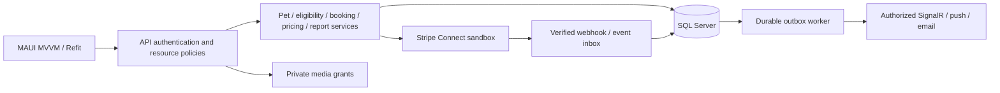

# End-to-end data flow

All target interfaces/methods below are proposed; existing anchors are named explicitly. Keep controller → service → EF dependency pattern, DI and MAUI MVVM/Refit. Use cancellation tokens and typed contracts. Controllers translate expected failures to safe RFC ProblemDetails (400 validation, 401 unauthenticated, 403/404 resource policy, 409 conflict/stale transition, 422 ineligible, 503 unavailable dependency). Correlation IDs and redacted logs connect operations; never log tokens, care secrets or payment client secrets.

## Authentication

Current: `DogWalkerApi/Program.cs` registers incomplete JWT middleware; `DogWalkerApp/Services/Storage/SecureStorageService.cs` is a wrapper unused by identity. No login exists.

Target: LoginViewModel → system browser/OIDC authorization-code + PKCE → approved identity provider → IAuthenticationSession refresh/secure token storage → Refit bearer handler / SignalR access-token callback → validated issuer/audience/signature/expiry in API → ICurrentActor resolves subject to Account/Client/Walker roles. Backend Account provisioning stores subject mapping, consent and role assignments in SQL; credentials stay with identity provider. Admin role cannot self-register. External identity-provider choice remains a product/security decision, not a fictional endpoint. Check issuer keys/revocation behavior, refresh rotation and logout cleanup. Offline credentials never authorize server mutations. Fail closed on invalid tokens; refresh once, then reauthenticate.

## Pet registration

Current: `ClientsController.AddDog` → IClientService.AddDogAsync → ClientService checks Client existence → Dogs collection → SaveChanges → AutoMapper DogDto. `DogsController` lists all dogs with no owner boundary.

Target: species-first PetProfileViewModel → IDogWalkerApi v2 CreatePetAsync(CreatePetRequest) → PetsController.Create → validator checks active species, typed definition versions/units/ranges → IPetService.CreateAsync(ICurrentActor, request) verifies household ownership → SQL transaction inserts Pet/Profile/Requirements and audit → restricted PetDto. Catalog is public/minimized; medical/contact details owner-only or assigned active caregiver with time-limited need-to-know scope. Rowversion protects updates. Unsupported species returns explicit policy error. Duplicate retry keys return same creation, not extra pets. Existing dog routes adapt for authorized dog-only users.

## Booking

Current: BookingsViewModel → CreateBookingRequest(one DogId) → BookingsController.CreateBooking → BookingService.CreateAsync → fixed CalculatePrice → SaveChanges; no eligibility/availability.

Target: MultiPetBookingViewModel → EligibilityController.Search → IEligibilityService.EvaluateAsync reads capabilities/qualification policy/species/availability/location and returns explainable candidates. QuoteController.Create → IPricingService.QuoteAsync reads PriceRule/Fee/Cancellation versions, writes immutable Quote/Lines with expiry. BookingController.Request → IBookingService.RequestAsync validates actor, owner/pets/habitats, quote, eligibility → IAvailabilityService.ReserveAsync locks provider schedule and checks overlap/capacity → SQL transaction inserts Booking/BookingPet/BookingTask snapshots/Reservation/Transition/Outbox. Accept endpoint rechecks qualifications/expiry/capacity; stale quote requires explicit requote consent. Worker emits notifications after commit. Owner history is paginated by owner/pet/household, unlike current upcoming-walker-only endpoint. Unique idempotency scope(actor,operation,key) and payload hash reject key reuse with a different payload.

## Payment

Current: BookingsController.CreatePaymentIntent → IPaymentService.CreateOrUpdateIntentAsync(bookingId, caller amount, tip) → Stripe PaymentIntent → Payment row. PaymentDto has no client secret; no mobile payment UI, webhook or Connect account. UpdateStatus stores Completed before CaptureAsync.

Target: authenticated payment initiation → IPaymentService.PrepareCheckoutAsync(actor,bookingId,idempotencyKey) verifies owner/accepted state and persisted quote → Stripe test-mode Connect charge strategy → private checkout response with short-lived client secret → approved MAUI payment UI/SDK integration → Stripe → PaymentsWebhookController.Handle reads raw body, verifies signature using protected webhook secret → unique PaymentEvent record → IMarketplacePaymentReconciler.ApplyAsync → transaction updates payment/booking condition/history/outbox. Booking reaches Confirmed only when policy's actual payment requirement is satisfied and reservation valid. Keep payment state separate from visit state. External calls happen outside DB transaction; durable operation/reconciliation handles crash between Stripe and SQL. Verify connected account capabilities and transfer eligibility; payout ledger/reconciliation is independent of UI earnings estimates.

Current capture configuration is inconsistent with manual capture. Choose approved policy before implementation: deposit/charge at confirmation with later transfer, or authorization only inside card/network authorization validity windows. Far-future visits cannot assume indefinite authorization. Cancellation/refund uses persisted policy, provider transfer reversal where needed and idempotent operation; dispute freezes relevant funds and opens admin incident. Stripe source of truth is verified event/API state, never mobile success callbacks alone. Sandbox only until separate commercial approval.

## Care checklist/report/media

Current: WalkTrackerViewModel invents booking ID, MediaUploadRequest sends local path; API persists URLs and broadcasts MediaShared; no task/report tables.

Target: CareReportViewModel loads assigned BookingTask snapshot → CareReportsController.CompleteTask → ICareReportService.CompleteTaskAsync verifies assignment/state/pet or habitat scope → append TaskCompletion(actor,time,note,measurement/unit,version) with immutable revisions → SQL. IMediaService.RequestUploadAsync verifies scope and creates short-lived upload grant → private object storage validates size/magic type, scan/quarantine/strip sensitive metadata → FinalizeUpload verifies stored object → MediaAsset associates booking/pet/task → scoped signed read URL only for participants. Never store a handset file path as accessible media. CompleteVisit requires per-pet report and mandatory tasks or approved reason; incident can block completion/escalate emergency instructions. Outbox notification worker informs owner; mobile fetches per-pet reports, not only shared photos.

## Messaging and notifications

Current: MessagesController → MessageService persists Thread/Message, but does not emit MessageReceived; WalkHub permits anonymous joining/sending.

Target: IMessagingService.SendAsync derives sender from principal, validates booking participants and bounds/rate limits body, commits message + outbox → authorized SignalR group notification (MessageReceived). Thread membership and replay-after-last-message support reconnect; deduplicate by message ID. Database is history source. Reconnect reauthorizes/rejoins groups. Push uses platform provider supported by selected integration (FCM/APNs), minimal payload with authenticated fetch; email SDK dependency alone is not an implemented service. Durable retries/backoff/dead-letter monitoring and inbox/outbox prevent committed booking/payment changes losing notifications. Sensitive care data never appears on lock-screen notifications.

